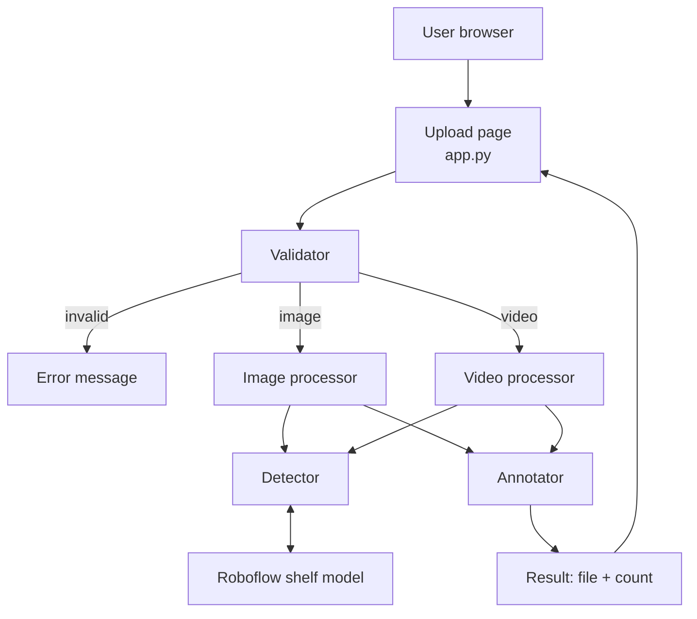
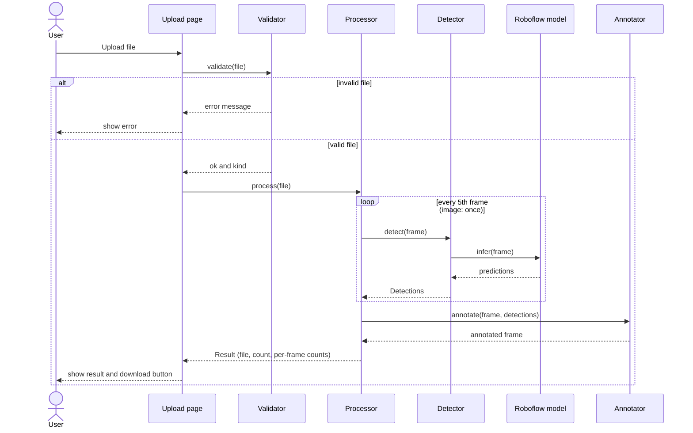
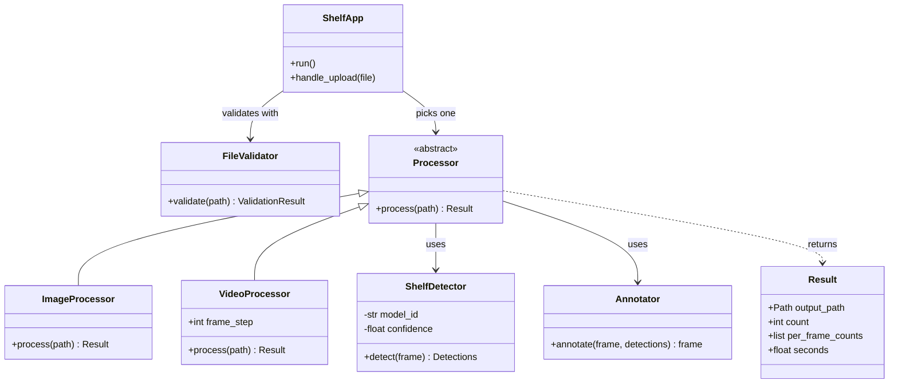
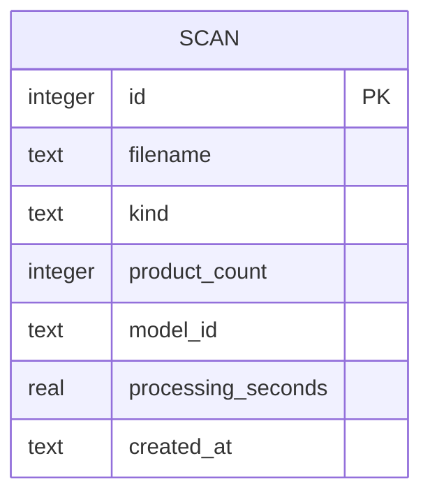

# Architecture

## 1. Overview

The app is a single local Python process. A Streamlit page accepts an upload, a validator checks it, a processor runs it through the detector, and an annotator draws the result. The only external dependency is the Roboflow shelf model.

## 2. Components

| Component | File | Responsibility |
| --- | --- | --- |
| Upload page | `app.py` | File upload, shows result, count and download button, shows errors |
| Config | `src/config.py` | Settings and limits, reads `.env` |
| Validator | `src/validator.py` | Checks file type, size, video duration, and that the file can be read, before any processing |
| Errors | `src/errors.py` | Turns model, key and network failures into plain-English messages |
| Detector | `src/detector.py` | Wraps Roboflow Inference; returns Supervision `Detections` |
| Annotator | `src/annotator.py` | Draws boxes and the product count on a frame |
| Image processor | `src/processors.py` | Image path: read, detect, annotate, save |
| Video processor | `src/processors.py` | Video path: read frames, detect every Nth frame, annotate, write video |
| Roboflow model | external | Pretrained shelf detection model |

## 3. Component flow



## 4. Sequence of one upload



## 5. Class diagram



## 6. Do we need a database?

**No.** The reasons:

- The app handles one file at a time and keeps nothing between uploads.
- Results are files the user downloads. Nothing needs to be queried later.
- The brief has no accounts, history, or reporting.
- Configuration (API key, model ID, confidence) lives in `.env`.

A database would add setup steps and work the brief doesn't ask for, and it would put the 10-minute setup target at risk.

### Optional future extension: scan history

If the project owner later wants history, use one SQLite table. This is not part of the current scope.



## 7. Key design decisions

| Decision | Reason |
| --- | --- |
| Validate before processing | Rejects bad files cheaply, with a clear message, before the model is loaded or called |
| Load the model once and cache it | Loading on every upload would break the 5-second target |
| Detect every 5th video frame and reuse results in between | Meets the "every 5th frame" speed requirement while still giving every frame boxes and a count |
| Detector and annotator as separate classes | The model can be swapped (for example to YOLO-World) without touching drawing code |
| Image and video share a `Processor` base class | Same flow, different frame source; keeps the page code simple |
| No label text on boxes | Shelves are dense, labels would clutter the image; the count overlay is enough |
| Config in `.env`, limits in `config.py` | Keeps the API key out of Git and limits easy to change |
| `.env` is read with `dotenv_values`, not exported to the environment | The `inference` package parses `CONFIDENCE` itself on import, so a bad value would crash it before the app's own checks. Real environment variables still override `.env` |
| Bad settings warn instead of crashing | A non-numeric or out-of-range `CONFIDENCE` falls back to the default or the nearest limit, with a warning on the page |
| Temporary file for uploads | OpenCV and Supervision read from a path, not from memory |

## 8. Configuration

| Setting | Where | Default |
| --- | --- | --- |
| `ROBOFLOW_API_KEY` | `.env` | none (required) |
| `MODEL_ID` | `.env` | none (required, `project-name/version`); chosen: `planogram_sku110k/1` |
| `CONFIDENCE` | `.env` | 0.3 |
| `PRODUCT_CLASS` | `.env` | `0` (the only class of the chosen model) |
| `MAX_DETECTIONS` | `src/config.py` | 1000 (Inference defaults to 300, which undercounts packed shelves) |
| `MAX_IMAGE_MB`, `MAX_VIDEO_MB`, `MAX_VIDEO_SECONDS` | `src/config.py` | 10, 100, 30 |
| `FRAME_STEP` | `src/config.py` | 5 |
| `VIDEO_MAX_WIDTH` | `src/config.py` | 1280 (wider video frames are scaled down before detection) |

## 9. Folder layout

```
shelf-counter/
  app.py
  requirements.txt
  .env.example
  .gitignore
  README.md
  docs/
    PRD.md
    PHASES.md
    ARCHITECTURE.md
    TESTING_AND_MODEL_SELECTION.md
  src/
    config.py
    validator.py
    errors.py
    detector.py
    annotator.py
    processors.py
  tests/
    test_validator.py
    test_video.py
    test_errors.py
  samples/
    inputs/
    outputs/
```

## 10. Known technical risks

- Video output format: OpenCV can only write MPEG-4 Part 2 (`mp4v`), which browsers do not play. Resolved: the video processor re-encodes to H.264 with ffmpeg. Without ffmpeg the video still downloads but may not play in the page.
- Local CPU inference may exceed 5 seconds. Measure in Phase 2 and consider resizing images or hosted inference.
- The `inference` package is large; first install is slow.
