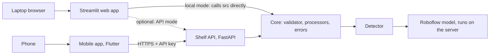

# Mobile and Web: Plan for Two Apps

Status: Proposal, needs approval · Branch: `develop` · Date: 2026-10-12

## 1. Summary

The current app is a Streamlit web page that runs on a laptop. This document proposes adding a mobile app next
to it, so a user can photograph or film a shelf with their phone and get the products boxed and counted.

The recommended approach is **one backend, two apps**: a small API service runs the model, and both the
Streamlit web app and a new mobile app call it. The existing Streamlit app keeps working exactly as it does
today, so the original brief stays met.

This is outside the original brief, which asks for "Streamlit or Gradio" and "running locally on a laptop".
It needs the project owner's approval before Phase 7 starts (see section 9).

## 2. The constraint that shapes everything

A phone cannot run the current model. Detection uses PyTorch and the Roboflow `inference` package, about
1.5 GB of Python libraries that only run on a desktop or a server. So any mobile version has to send the photo
to a computer that runs the model and returns the result.

Running the model on the phone itself would need the model converted to a mobile format. The Roboflow model's
weights and license may not allow that. It is listed as research in section 8, not as a phase.

## 3. Options considered

| Option | What it means | Effort | Verdict |
| --- | --- | --- | --- |
| A. One web app that works on phones | Deploy the Streamlit app with HTTPS and a password; phones use the browser. The upload box already offers "Take photo" on phones | 1 to 2 days | Cheapest. Feels like a website, not an app |
| **B. Two apps, one backend** | Keep Streamlit for laptops, add a mobile app. Both call one API that runs the model | 2 to 3 weeks | **Recommended** if a real mobile app is wanted |
| C. One app for both | Rebuild the interface once in Flutter or React Native for web, Android and iOS, with the same API | 3 to 4 weeks | Cleanest long term, but replaces the Streamlit app the brief asks for |
| D. Model on the phone | Convert the model and run it offline on the device | Unknown | Research only (section 8) |

Option A is not wasted work under option B: the API in Phase 7 is the first step of both.

## 4. Recommended architecture

- **Core** is the code that exists today in `src/`: validation, image and video processing, error messages.
  It does not change.
- **Shelf API** is a thin FastAPI service around the core. It is new.
- **Streamlit** keeps calling `src/` directly when it runs locally, so the version that meets the brief cannot
  break. It can optionally use the API when deployed.
- **Mobile app** is new and only talks to the API.

## 5. Phases

All work happens on `develop`. Each phase is merged into `master` only after its exit criteria pass.
Estimates assume one developer, new to Flutter.

### Phase 7: Shelf API (2 to 3 days)

**Goal:** the existing pipeline behind an HTTP API.

**Tasks**

- [ ] FastAPI service with:
  - `POST /count/image`: returns the count, the annotated image and the processing time
  - `POST /video-jobs`: starts a video job and returns a job ID
  - `GET /video-jobs/{id}`: returns progress, then the count per frame and the annotated video
  - `GET /health`
- [ ] Video runs as a background job, because it takes 15 to 40 seconds, too long for one phone request.
- [ ] Reuse `validate()`, `ImageProcessor`, `VideoProcessor` and `friendly_message()`, so both apps show the
      same errors.
- [ ] Require an API key on every request. Keep the upload limits, and add a simple rate limit.
- [ ] Tests with FastAPI's test client, reusing the existing test files.

**Exit criteria:** sending an image with `curl` returns the same count as the Streamlit app, and every Phase 5
error case returns the same plain-English message.

### Phase 8: Deploy the API (1 to 2 days)

**Goal:** a public HTTPS address the phone can reach.

**Tasks**

- [ ] Docker image: Python 3.12, CPU-only PyTorch, ffmpeg, model cache built in.
- [ ] Host on Hugging Face Spaces, Render or Railway (all give HTTPS). Vercel cannot host this; see section 7.
- [ ] Store the Roboflow key and the API key as host secrets, never in Git.
- [ ] Logging and a health check.
- [ ] Measure cold start, memory use, and time per photo over the network.

**Exit criteria:** the public endpoint answers in under 5 seconds per photo, network included, once warm.

### Phase 9: Mobile app (5 to 8 days)

**Goal:** an Android app that photographs or films a shelf and shows the counted result.

**Tasks**

- [ ] **Camera or gallery screen:** the native camera at full resolution, plus a "keep people out of the
      frame" reminder.
- [ ] **Result screen:** the annotated image, the count, and a share or save button.
- [ ] **Video:** record or pick a clip, upload with a progress indicator, then show the result and a
      per-frame chart.
- [ ] **Settings:** confidence threshold and server address.
- [ ] Handle iPhone formats (`.heic` photos, `.mov` videos), in the app or in the API.
- [ ] Errors: no network, server waking up, file too large, wrong key. Show the API's messages as they are.

**Exit criteria:** on a real Android phone, a photo and a 10-second video each come back counted.

### Phase 10: Release and demo (1 to 3 days)

**Tasks**

- [ ] Android: a sideloaded APK for the demo, or a Google Play internal test track (25 USD, once).
- [ ] iOS, only if required: needs a Mac and an Apple Developer account (99 USD a year).
- [ ] Update README and STARTUP.md for both apps, and add API documentation.
- [ ] Demo: one photo and one video from the phone, plus the laptop web app.

**Exit criteria:** a teammate installs the app and gets a counted photo without help.

### Timeline

| Phase | Effort |
| --- | --- |
| 7. Shelf API | 2 to 3 days |
| 8. Deploy the API | 1 to 2 days |
| 9. Mobile app | 5 to 8 days |
| 10. Release and demo | 1 to 3 days |
| **Total** | **about 2 to 3 weeks** |

Starting with Android only avoids the Mac and the iOS account.

## 6. Pros and cons

### Pros

- **Better phone experience:** the native camera at full resolution, a real app icon, no browser bar. Full
  resolution matters, because small images miss products (a 202x360 test photo found far fewer).
- **One brain, two faces:** the model, validation and counting live in one place. A fix in the core fixes both
  apps.
- **The brief's deliverable stays safe:** the Streamlit app is still local-first and still meets every
  "Done when" item.
- **Reusable API:** other systems, such as a store dashboard or a scheduled shelf check, could call it later.
- **Strong demo:** photographing a shelf with a phone and seeing it counted is more convincing than a laptop
  upload.

### Cons

- **Outside the brief:** a new scope that needs the project owner's approval.
- **Deployment becomes mandatory:** hosting costs, uptime and monitoring. Free tiers sleep and are low on
  memory.
- **Photos leave the device:** privacy questions, and the "no people in photos" rule is harder to enforce with
  a live camera.
- **More to secure:** a public API needs authentication, rate limits and abuse protection, or anyone can use up
  the Roboflow quota.
- **Two languages, two codebases:** Python and Dart (Flutter) double the testing and setup docs. The
  "teammate runs it in 10 minutes" goal gets harder.
- **Network dependence:** no signal means no count. Videos are large on mobile data and may need trimming or
  compression in the app.
- **App store friction:** iOS needs a Mac and a paid account, and store reviews add delays.
- **Model license:** still unconfirmed, and serving the model publicly makes it matter more.

## 7. Can it be deployed on Vercel?

**No.** Streamlit needs a server that stays running and holds a WebSocket open to the browser, and Vercel runs
short-lived serverless functions that do not support that. The dependencies (PyTorch and `inference`, about
1.5 GB) are also far over Vercel's limit of about 250 MB per function.

Hosts that fit: Hugging Face Spaces, Render, Railway, Fly.io (Docker), or Streamlit Community Cloud (free, but
its memory may be tight for PyTorch).

A lighter alternative is to call Roboflow's hosted API instead of running the model, which removes PyTorch
entirely and makes deployment easy. The trade-offs are that photos go to Roboflow and each call counts against
the Roboflow plan.

## 8. Risks and open research

| Risk | Impact | Mitigation |
| --- | --- | --- |
| Free hosting is too slow or runs out of memory | High: misses the 5-second target | Measure in Phase 8; pay for a small instance or use Roboflow's hosted API |
| Public API is abused | High: Roboflow quota and costs | API key, rate limit, upload limits from day one |
| Model license does not allow public serving | High | Confirm the license before Phase 8 |
| Phone videos too large on mobile data | Medium | Trim or compress in the app; keep the 30-second limit |
| Developer new to Flutter | Medium: estimates slip | Android only first; keep the app to four screens |
| Running the model on the phone | Unknown | Research only: check whether the Roboflow model can be exported to a mobile format and whether its license allows it |

## 9. Decisions needed before starting

1. **Project owner approval:** is a mobile app wanted, given that it is outside the brief?
2. **Platforms:** Android only, or Android and iOS?
3. **Option A first?** Deploying the Streamlit app for phones (1 to 2 days) may be enough for the demo.
4. **Hosting budget:** free tier, a small paid instance, or Roboflow's hosted API.
5. **Framework:** Flutter (proposed) or React Native, depending on the team's experience.

## 10. Recommended order

1. Finish the brief's deliverables first: 5 samples, true counts, the teammate test and the demo.
2. Get answers to section 9.
3. Start Phase 7 (the API). It supports both option A and option B, and it does not touch the current
   Streamlit app.
