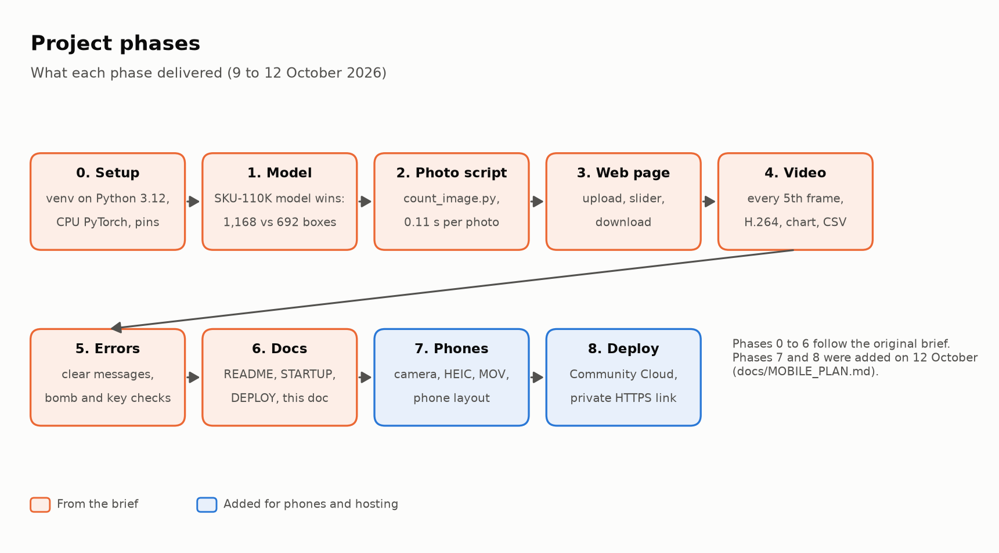
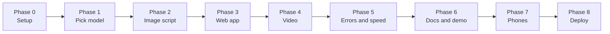

# Project Phases

This plan breaks the project into nine phases. Phases 0 to 2 are the foundation, 3 to 5 are the build, and 6 is delivery. Phases 7 and 8 were added on 12 October 2026 to make the app work well on phones and to put it online ([MOBILE_PLAN.md](MOBILE_PLAN.md)). Phase 1 is the biggest risk, because everything after it depends on the model being good.

Status on 12 October 2026: Phases 0 to 5, 7 and 8 are done. Phase 6 is partly done: the documentation is written; the samples, the teammate test and the demo are still open. What each phase delivered is summarised in [PROJECT_DOCUMENTATION.md](PROJECT_DOCUMENTATION.md), section 15.

Effort estimates are suggestions only. The brief gives no deadline.

| Phase | Name | Suggested effort | Main output |
| --- | --- | --- | --- |
| 0 | Setup | 0.5 day | Working environment, repo, API key |
| 1 | Test data and model selection | 1 to 2 days | Chosen model ID and comparison table |
| 2 | Single-image script | 0.5 to 1 day | Script that boxes and counts one image |
| 3 | Image web app | 1 day | Upload page for images |
| 4 | Video support | 1 to 2 days | Annotated video with per-frame counts |
| 5 | Validation and error handling | 0.5 to 1 day | Clear errors, speed check |
| 6 | Docs and deliverables | 1 day | README, samples, demo |
| 7 | Phone-friendly web app | 1 to 2 days | Camera mode, iPhone formats, phone layout |
| 8 | Deploy on Streamlit Community Cloud | 0.5 to 1 day | Private HTTPS link |

---

## Phase 0: Setup

**Goal:** a clean environment where a one-image script can run.

**Tasks**

- [x] Create a free Roboflow account and copy the API key.
- [x] Install Python 3.10 or newer.
- [x] Create a virtual environment and install `inference`, `supervision`, `streamlit`, `opencv-python-headless`, `python-dotenv`.
- [x] Copy `.env.example` to `.env` and add the API key.
- [x] Confirm `.env` is in `.gitignore` before the first commit.
- [x] Make the first Git commit.
- [x] Run `pip freeze` and pin versions in `requirements.txt`. _(direct dependencies pinned, plus CPU-only PyTorch)_

**Exit criteria:** `python -c "import inference, supervision, streamlit"` runs without errors, and `.env` is not tracked by Git.

**Risks:** the `inference` install is large and slow. Give it time and note this in the README.

---

## Phase 1: Test data and model selection

**Goal:** choose the model that misses the fewest products. This is the highest-risk phase.

**Tasks**

- [ ] Take 10 shelf photos with no people in frame. Vary lighting, angle and shelf density. _(10 web images used so far; still need 10 of your own photos)_
- [ ] Record a few short shelf videos (under 30 seconds). _(one 4.3 s clip so far)_
- [x] Search Roboflow Universe for "retail shelf", "SKU-110K" and "shelf products".
- [x] Keep only projects that have a trained model attached (a model tab where you can test an image). Many projects are datasets only.
- [x] Shortlist 2 or 3 candidates.
- [x] Test each candidate in the browser, then run it on all 10 photos. _(run on all 10 photos with scripts/evaluate.py)_
- [ ] For each photo, count the real products by eye and record what each model found. _(true_counts.csv is still empty)_
- [x] Pick the winner and write down its model ID (`project-name/version`) and why it won. _(planogram_sku110k/1; the reason is based on boxes found until true counts are added)_
- [ ] Fallback only if all candidates are poor: use an open-vocabulary model such as YOLO-World. _(not needed: the SKU-110K model works)_

**Deliverable:** a completed comparison table (template in `TESTING_AND_MODEL_SELECTION.md`) and a chosen model ID in `.env`.

**Exit criteria:** one model chosen, with numbers to justify it.

**Risks:** the model names in the original brief came from memory and may be wrong. Confirm what exists before committing.

---

## Phase 2: Single-image script

**Goal:** prove the pipeline end to end on one image before building any UI.

**Tasks**

- [x] Load an image with OpenCV.
- [x] Run the model through Roboflow Inference.
- [x] Convert the result to a Supervision `Detections` object.
- [x] Draw boxes and the count.
- [x] Save the annotated image and print the count.
- [x] Time the inference call.
- [x] Try a few confidence values and note which works best.

**Starter code:** `src/detector.py`, `src/annotator.py`, `src/processors.py` (`ImageProcessor`).

**Exit criteria:** a good annotated image from at least 3 of your test photos, with timing recorded.

**Risks:** if one image already takes close to 5 seconds, decide now whether to resize inputs or use hosted inference.

---

## Phase 3: Image web app

**Goal:** the same pipeline behind an upload page.

**Tasks**

- [x] Build the Streamlit page in `app.py`: upload, annotated image, count, download button.
- [x] Load the model once and cache it (`st.cache_resource`), not on every upload.
- [x] Show a spinner while processing.
- [x] Show processing time.
- [x] Optional: confidence slider.

**Exit criteria:** upload a photo, see boxes and a count, and download the result, all in under 5 seconds after the first (warm-up) run.

**Risks:** loading the model on every upload will blow the speed target.

---

## Phase 4: Video support

**Goal:** accept a short `.mp4` and return an annotated video with a count per frame.

**Tasks**

- [x] Read frames with Supervision.
- [x] Run detection on every 5th frame and reuse the latest detections in between.
- [x] Draw boxes and the running count on every frame.
- [x] Write the annotated frames to a new `.mp4`.
- [x] Show the video in the page with a download button.
- [x] Show per-frame counts (for example a line chart).
- [ ] Test playback in the browser. _(output is browser-standard H.264; still to be watched in a real browser)_

**Starter code:** `src/processors.py` (`VideoProcessor`).

**Exit criteria:** a 10-second video returns an annotated video that plays in the browser, with a count for every frame.

**Risks:** some video encodings do not play in browsers. Re-encode with ffmpeg (H.264) if playback fails.

---

## Phase 5: Validation and error handling

**Goal:** bad input produces a friendly message, never a crash.

**Tasks**

- [x] Accept only `.jpg`, `.jpeg`, `.png` and `.mp4`.
- [x] Enforce size limits and the 30-second video limit.
- [x] Handle unreadable or corrupt files.
- [x] Handle missing API key or model ID with a clear message.
- [x] Handle model or network failures with a clear message.
- [x] Test deliberately: upload a `.pdf`, a huge file, a 60-second video, and a renamed text file. _(a 31 s video was used for the length limit)_
- [x] Re-time the image path against the 5-second target.

**Starter code:** `src/validator.py`, `tests/test_validator.py`.

**Exit criteria:** every error case in the test matrix shows a plain-English message.

---

## Phase 6: Docs and deliverables

**Goal:** make the project easy to run, review and demo.

**Tasks**

- [ ] Finish the README: setup, how to run, model ID and why, known limits. _(done except the missed-products numbers and the model license)_
- [x] Write the setup guide (STARTUP.md), the deployment guide (DEPLOY.md), a detailed PRD and the project documentation with diagrams (PROJECT_DOCUMENTATION.md).
- [ ] Pick 5 example inputs, including good results and honest limits. Save each input and its annotated output in `samples/`.
- [ ] Ask a teammate to follow the README cold and time them. Fix anything that slows them down.
- [ ] Rehearse the demo: one photo, one video, results on screen.
- [ ] Final check of the acceptance criteria in `PRD.md`.

**Exit criteria:** all acceptance criteria and deliverables in `PRD.md` are ticked.

---

## Phase 7: Phone-friendly web app (done 12 October 2026)

**Goal:** the Streamlit app works well in a phone browser, including taking the photo with the camera.

**Tasks**

- [x] Add **Take a photo** with `st.camera_input` (1080p requested), switched with a segmented control.
- [x] Accept iPhone photos (`.heic`, `.heif`): read with `pillow-heif`, apply the EXIF rotation, show a preview.
- [x] Accept iPhone videos (`.mov`, H.264 or HEVC); the result is always an H.264 `.mp4`.
- [x] Move the confidence slider from the sidebar (hidden on phones) into a **Detection settings** popover.
- [x] Keep the metrics side by side on phones, so the result photo is near the top.
- [x] Add the "keep people out of the frame" reminder and alt text on images, video and chart.
- [x] Tests for HEIC and `.mov` (`tests/test_formats.py`); check in Chrome at desktop and phone size with a fake camera.
- [ ] Watch it on a real iPhone after the next push: a `.heic` photo and a `.mov` video.

**Exit criteria:** from a phone, a photo and a 10-second video come back counted. _(Met in Chrome at phone size;
confirm on a real phone once pushed.)_

---

## Phase 8: Deploy on Streamlit Community Cloud (done 12 October 2026)

**Goal:** a free, private HTTPS link that works on a laptop and a phone.

**Tasks**

- [x] Prepare the repo: `packages.txt` (ffmpeg and OpenCV system libraries), `uv.toml` (CPU-only PyTorch resolves
  with Community Cloud's installer), no fixed server address, memory released after each video.
- [x] Load Streamlit secrets before the settings are read, so the key in the Secrets box is used.
- [x] Deploy from the private repo with Python 3.12 and the four secrets; invite viewers by email.
- [x] Write [DEPLOY.md](../DEPLOY.md), including what went wrong (Python 3.14 default, private repo access).
- [ ] Point the app at `master` once the merged version is pushed (DEPLOY.md step 10).

**Exit criteria:** invited viewers open the link on a phone and get a counted photo. _(Met.)_

Tried and dropped first: livemy.app (free plan too small, no settings screen). Vercel cannot run Streamlit.

---

## Dependency notes

- Phases are mostly sequential. Phase 1 gates everything.
- Phase 4 depends on Phase 3 only for the UI. The video pipeline itself can be prototyped as a script right after Phase 2.
- Phase 5 can start in parallel with Phase 4 for the image path.
