# Shelf Product Counter: project documentation

Status: live and working, 12 October 2026 (the Phase 7 features reach the live app with the next push of
`develop`) · Live app: https://shelf-counter-rahat.streamlit.app (private,
invited viewers only) · Repository: https://github.com/Rahat-Sultan/shelf-counter

This document explains what was built, how the code is organised, how the modules work together, how each phase
went, and what is still open. It is written for anyone who needs to understand, run, change or review the project.
For a quick setup, see [STARTUP.md](../STARTUP.md); for deployment, [DEPLOY.md](../DEPLOY.md); for the
requirements and their status, [PRD.md](PRD.md).

## Contents

1. [What the app does](#1-what-the-app-does)
2. [System overview](#2-system-overview)
3. [The modules](#3-the-modules)
4. [How a photo is processed](#4-how-a-photo-is-processed)
5. [How a video is processed](#5-how-a-video-is-processed)
6. [Upload checks](#6-upload-checks)
7. [Error handling](#7-error-handling)
8. [Settings and secrets](#8-settings-and-secrets)
9. [The page, on a laptop and a phone](#9-the-page-on-a-laptop-and-a-phone)
10. [Choosing the model](#10-choosing-the-model)
11. [Speed and memory](#11-speed-and-memory)
12. [Deployment](#12-deployment)
13. [Testing](#13-testing)
14. [Security and privacy](#14-security-and-privacy)
15. [Phases: what was done when](#15-phases-what-was-done-when)
16. [Key decisions](#16-key-decisions)
17. [Known limits and open items](#17-known-limits-and-open-items)
18. [How to extend the project](#18-how-to-extend-the-project)
19. [Glossary](#19-glossary)
20. [Regenerating the images](#20-regenerating-the-images)

---

## 1. What the app does

A user opens a web page, gives it a picture of a retail shelf, and gets the picture back with every product boxed
and counted. Three kinds of input work:

- a **photo**: `.jpg`, `.png`, or an iPhone `.heic`, up to 10 MB;
- a **video**: `.mp4` or an iPhone `.mov`, up to 30 seconds and 100 MB;
- a **camera photo**, taken in the page with the laptop webcam or the phone camera.

For a photo the page shows the number of products, the processing time, the annotated photo next to the original,
and a download button. For a video it shows the highest and average count per frame, the annotated video, a chart
of the count over time, and downloads for the video and a CSV of per-frame counts.

The detection uses a pretrained model from Roboflow Universe (`planogram_sku110k/1`, trained on the SKU-110K shelf
dataset). There is no data labelling and no training in this project, as the brief required.

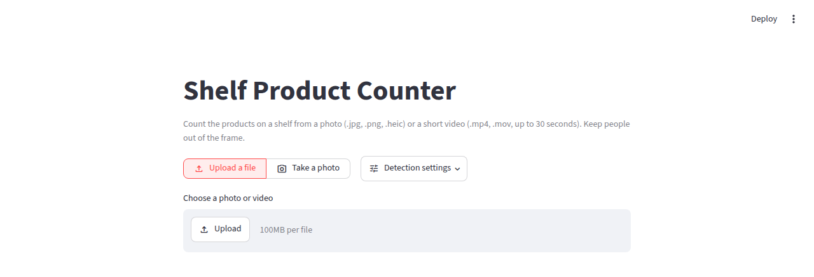

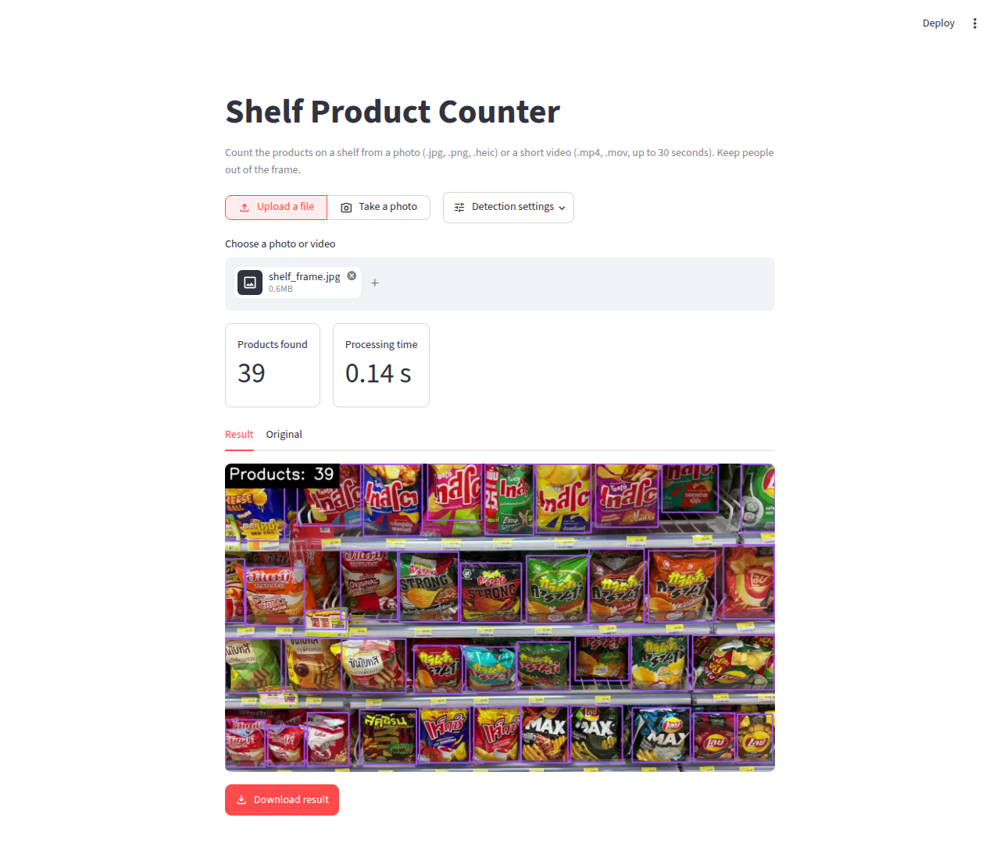

---

## 2. System overview

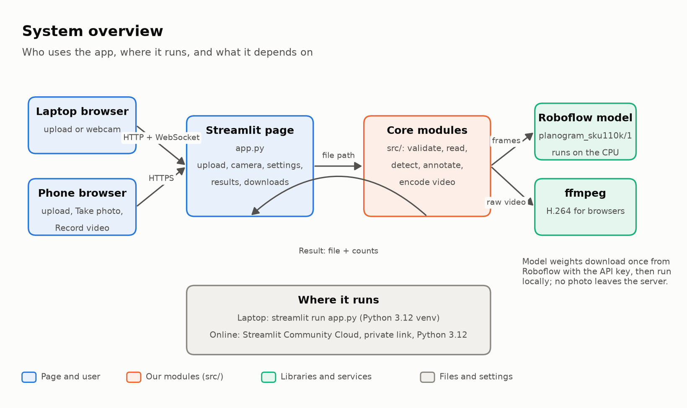

The app is a single Python process running [Streamlit](https://streamlit.io). Streamlit serves the page to the
browser and runs `app.py` every time the user interacts. `app.py` hands the uploaded file to the **core modules**
in `src/`, which check the file, run the model, draw the boxes and, for video, re-encode the result.

Two outside pieces do the heavy lifting:

- **Roboflow Inference** loads the model weights (downloaded once with the API key, about 7.5 MB) and runs them on
  the CPU. No GPU is needed, and photos are not sent to Roboflow.
- **ffmpeg** converts annotated videos to H.264, the format every browser can play.

The same code runs in two places: on a laptop (`streamlit run app.py` in a Python 3.12 virtual environment) and on
Streamlit Community Cloud, which gives the private HTTPS link that also works on phones.

There is no database. Each upload is processed in a temporary folder that is deleted afterwards; nothing is kept
between uploads (see `docs/ARCHITECTURE.md`, section 6, for why).

---

## 3. The modules

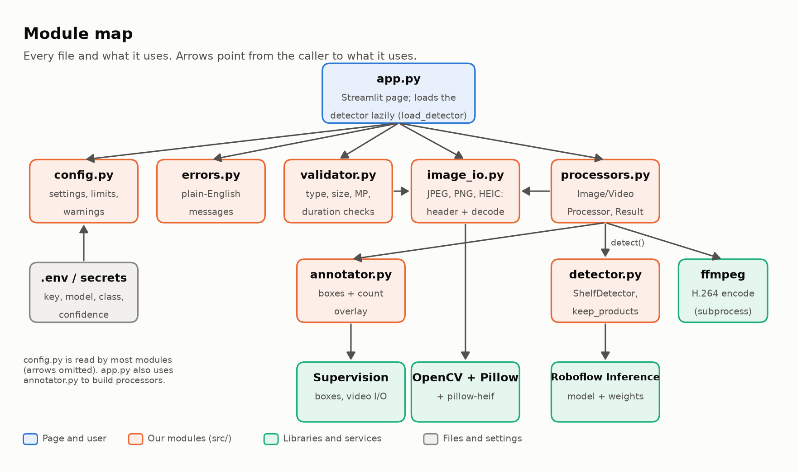

| File | Responsibility | Main contents | Used by |
| --- | --- | --- | --- |
| `app.py` | The Streamlit page: input choice, settings, running the pipeline, showing results | `load_detector()` (cached), page layout, result display | Streamlit |
| `src/__init__.py` | Runs first whenever `src` is imported: points the model cache at `~/.cache/shelf-counter/models` | one `os.environ.setdefault` | every `src` module |
| `src/config.py` | All settings and limits in one place; reads `.env` and environment variables safely | `ROBOFLOW_API_KEY`, `MODEL_ID`, `CONFIDENCE`, limits, `WARNINGS` | all modules |
| `src/validator.py` | Checks an upload before anything is decoded | `validate()`, `ValidationResult`, `image_megapixels()`, `video_duration_seconds()` | `app.py` |
| `src/image_io.py` | Reads photos, including iPhone HEIC that OpenCV cannot open | `can_read_header()`, `read_image()` | validator, processors, `app.py` |
| `src/processors.py` | The photo and video pipelines | `ImageProcessor`, `VideoProcessor`, `Result`, `fit_width()`, `encode_for_browser()`, `release_memory()` | `app.py`, scripts |
| `src/detector.py` | Wraps the Roboflow model so nothing else touches Inference directly | `ShelfDetector.detect()`, `keep_products()` | processors (loaded lazily by `app.py`) |
| `src/annotator.py` | Draws boxes and the "Products: N" panel | `Annotator.annotate()` | processors |
| `src/errors.py` | Turns any failure into one plain-English sentence | `UserFacingError`, `friendly_message()` | `app.py`, processors |
| `scripts/count_image.py` | Counts photos from the command line | `python -m scripts.count_image photo.jpg` | developers |
| `scripts/evaluate.py` | Compares models and confidence values on a folder of photos | writes `outputs/eval/results.csv` | developers (Phase 1) |
| `scripts/probe_models.py` | Checks whether a Universe model ID loads and lists its classes | | developers (Phase 1) |

### How the modules depend on each other

- **`app.py` is the only place that knows about Streamlit.** Everything in `src/` is plain Python, so it can be
  used from scripts and tests without a browser.
- **The detector is imported lazily.** Importing Roboflow Inference takes 10 to 20 seconds. `app.py` imports
  `src.detector` only inside `load_detector()`, and `processors.py` refers to it only for type hints. That is why
  the page draws within a few seconds while the model loads in the background (a test guards this:
  `test_page_modules_do_not_import_inference`).
- **The processors know nothing about the model.** They call `detector.detect(frame, confidence)` and get boxes
  back, so a different model (for example YOLO-World) can be swapped in by changing `detector.py` alone.
- **One `Result` comes back from both pipelines**: the output file, the count, the per-frame counts, the seconds
  taken, the frame rate and an optional note. The page only reads `Result`; it does not care how it was made.

### What each module does in detail

**`config.py`** reads `.env` with `dotenv_values()` into a dictionary and lays real environment variables over it.
It deliberately does **not** copy `.env` into the environment (see [section 8](#8-settings-and-secrets)).
`CONFIDENCE` is parsed safely: a value that is not a number falls back to 0.3, a value outside 0.05 to 0.95 is
clamped, and both add a message to `WARNINGS`, which the page shows. Limits live here as constants:

| Setting | Value | Why |
| --- | --- | --- |
| `MAX_IMAGE_MB` | 10 | from the brief's "too large" (PRD assumption A2) |
| `MAX_IMAGE_MEGAPIXELS` | 100 | blocks decompression-bomb images; covers 48 to 50 MP phone photos |
| `MAX_VIDEO_MB` | 100 | same value as Streamlit's upload limit in `.streamlit/config.toml` |
| `MAX_VIDEO_SECONDS` | 30 | from the brief |
| `FRAME_STEP` | 5 | the brief's "process every 5th frame" |
| `VIDEO_MAX_WIDTH` | 1280 | video frames are scaled down first; counts were identical, output 35 times smaller |
| `MAX_DETECTIONS` | 1000 | Inference stops at 300 boxes by default, which undercounted packed shelves |
| `CONFIDENCE` | 0.3 (from `.env`) | found more real products than 0.4 without adding false boxes |
| `PRODUCT_CLASS` | `0` | the chosen model's only class |

**`detector.py`** loads the model with `get_model(model_id, api_key)` and, for each frame, calls `infer()` with the
confidence and `MAX_DETECTIONS`, converts the result to a Supervision `Detections` object, and keeps only the
product class (`keep_products()`).

**`annotator.py`** scales the box line thickness to the image size (thin boxes on small, dense photos) and draws a
white "Products: N" label on a solid dark panel so it stays readable on busy shelves.

**`image_io.py`** has one job: give the rest of the code a BGR array (OpenCV's colour order) for any supported
photo. JPEG and PNG go through OpenCV, which also applies the EXIF rotation that phone cameras write. HEIC goes
through Pillow with the `pillow-heif` plug-in, and `ImageOps.exif_transpose` applies the same rotation.

**`processors.py`** holds both pipelines, described step by step in sections 4 and 5. It also contains three
helpers: `fit_width()` (scales a frame size down to 1280 px wide, keeping it even for H.264), `encode_for_browser()`
(runs ffmpeg; if ffmpeg is missing or fails, it keeps the playable-elsewhere `mp4v` file instead of failing), and
`release_memory()` (asks the C library to hand freed video buffers back to the operating system).

---

## 4. How a photo is processed

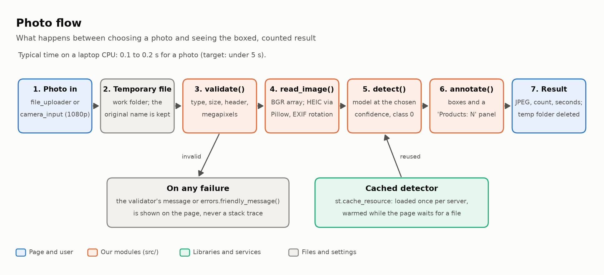

1. **Photo in.** The page gets an `UploadedFile` from the file uploader or the camera widget (which asks the
   camera for 1080p, the highest preset, because small images miss products).
2. **Temporary file.** The bytes are written into a fresh temporary folder, keeping the original name so the
   download is called `<name>_annotated.jpg`. The folder is deleted as soon as the result has been read.
3. **`validate()`** checks type, emptiness, size, header and megapixels ([section 6](#6-upload-checks)). If a check
   fails, its message is shown and processing stops.
4. **`read_image()`** decodes the photo to a BGR array, rotated the way the camera held it.
5. **`detect()`** runs the cached model at the confidence chosen in **Detection settings** and keeps class `0`.
6. **`annotate()`** draws the boxes and the count panel.
7. **Result.** The annotated JPEG is saved, and the page shows the count, the time, the result and original tabs,
   and the download button.

The model itself is loaded **once per server** with `st.cache_resource`. The page also calls `load_detector()` as
soon as it is drawn, while the user is still choosing a file. So the first upload is fast, and a wrong API key is
reported straight away instead of after the first upload.

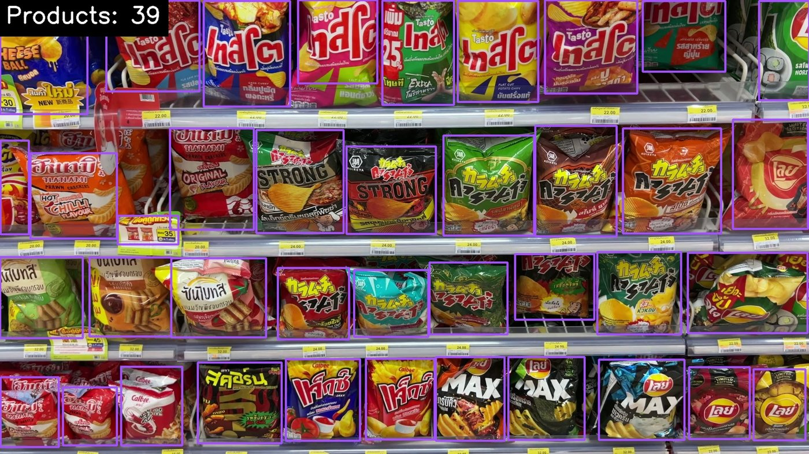

---

## 5. How a video is processed

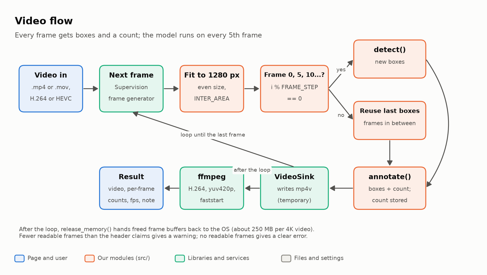

1. **Video in**: `.mp4` or `.mov`, H.264 or HEVC (the iPhone default). OpenCV reads all of them and applies the
   rotation flag of portrait phone videos.
2. **Frame loop.** Supervision's frame generator yields one frame at a time, so a whole video is never held in
   memory.
3. **Fit to 1280 px.** Wider frames are scaled down (`INTER_AREA`, even dimensions). The model works at about
   640 px internally anyway; on a test clip this changed no counts and cut the output from 114 MB to 3.2 MB.
4. **Every 5th frame** (`i % FRAME_STEP == 0`) goes to `detect()`. The frames in between reuse the last boxes, so
   every frame has boxes and a count (PRD FR-9 and FR-10).
5. **`annotate()`** draws on every frame, and the count is stored for the chart and CSV.
6. **`VideoSink`** writes the frames to a temporary `mp4v` file. OpenCV can only write that codec, and browsers do
   not play it.
7. **ffmpeg** re-encodes it to H.264 (`yuv420p`, `+faststart`), which plays in every browser.
8. **`release_memory()`** returns freed frame buffers to the operating system. Without it the process grew by
   about 250 MB per 4K video.
9. **Result.** The headline count is the **highest** per-frame count (PRD assumption A5), shown with the average.

Two damaged-file cases are handled: if no frame can be read, the user gets a clear error; if fewer than 90% of the
frames the header promises can be read (a truncated download), the result is shown with a warning such as
"Only 127 of 258 frames could be read".

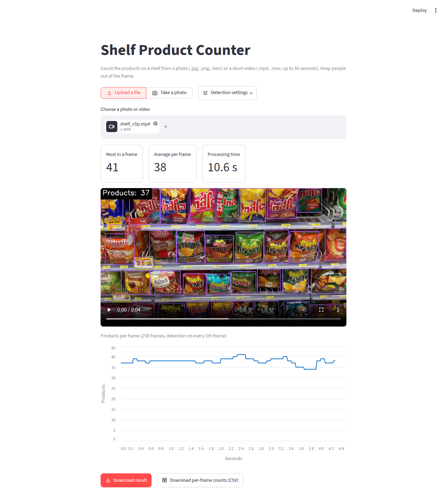

---

## 6. Upload checks

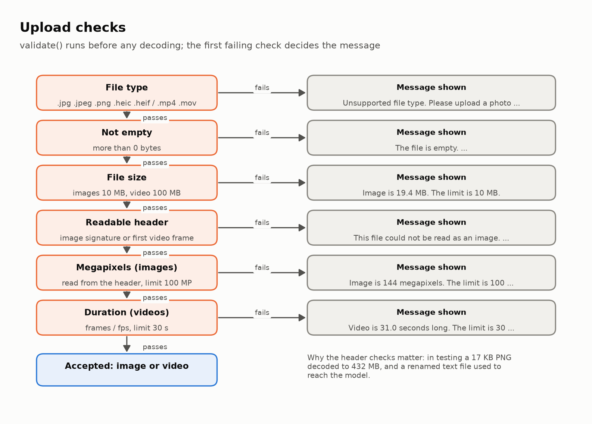

`validate()` is cheap and runs **before anything is decoded**. The order matters: the first failing check decides
the message, and each message says what the limit is.

| Check | Rule | Example message |
| --- | --- | --- |
| File type | `.jpg .jpeg .png .heic .heif` or `.mp4 .mov` | "Unsupported file type. Please upload a photo (.jpg, .png, .heic) or a video (.mp4, .mov)." |
| Not empty | more than 0 bytes | "The file is empty. Please upload a shelf photo or video." |
| File size | 10 MB for images, 100 MB for video | "Image is 19.4 MB. The limit is 10 MB." |
| Readable header | image signature, or a first video frame that decodes | "This file could not be read as an image. It may be damaged, or not really a .jpg, .png or .heic file." |
| Megapixels | width × height from the header, at most 100 MP | "Image is 144 megapixels. The limit is 100 megapixels." |
| Duration | frames ÷ frame rate, at most 30 s | "Video is 31.0 seconds long. The limit is 30 seconds." |

Two of these were added after testing found real problems: a **text file renamed to `.jpg`** used to reach the
model and fail with a generic error, and a **17 KB PNG decoded to 432 MB** of memory (a "decompression bomb";
about 100 KB could have frozen the laptop). The header check and the megapixel limit stop both.

---

## 7. Error handling

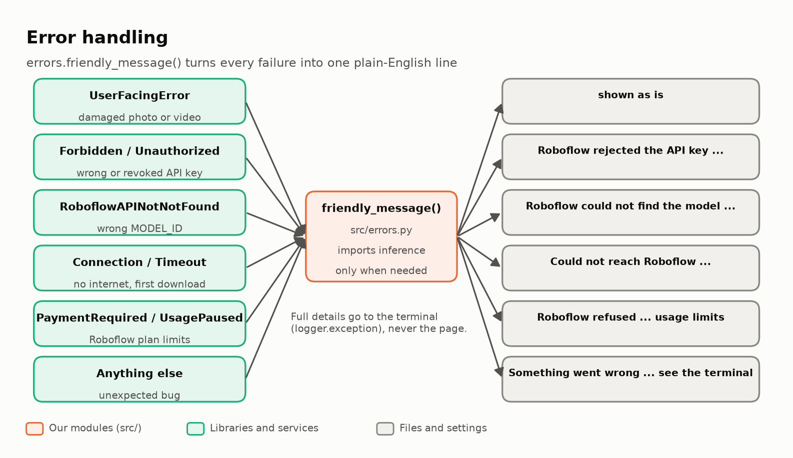

Every failure ends in one plain-English sentence on the page; the full technical detail goes to the terminal or
the Community Cloud log (`logger.exception`), never to the user (PRD FR-13).

| Failure | Where it comes from | Message |
| --- | --- | --- |
| Damaged or unreadable file | `UserFacingError` raised by the processors | the specific message, shown as is |
| Wrong or revoked API key | Roboflow `Forbidden` / `Unauthorized` | "Roboflow rejected the API key. Check ROBOFLOW_API_KEY ..." |
| Wrong or unversioned `MODEL_ID` | `RoboflowAPINotNotFoundError` | "Roboflow could not find the model '...'. ... It should look like project-name/version ..." |
| No internet on the first download | connection or time-out errors (Roboflow's and `requests`') | "Could not reach Roboflow to download the model. ..." |
| Roboflow plan limits | `PaymentRequired` / `UsagePaused` | "Roboflow refused to serve the model because of the account's plan or usage limits ..." |
| Settings missing | checked at the top of the page | "ROBOFLOW_API_KEY is not set. On your laptop, copy .env.example to .env ... On Streamlit Community Cloud, add them in App settings, Secrets ..." |
| Anything unexpected | any other exception | "Something went wrong while processing the file. Check the terminal for details and try again." |

`friendly_message()` imports the Roboflow exception classes only when it is called, so loading `errors.py` does
not pull in the slow `inference` import.

---

## 8. Settings and secrets

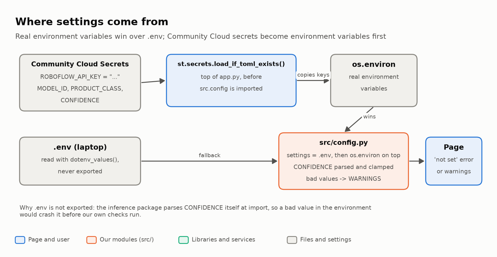

The four settings are `ROBOFLOW_API_KEY`, `MODEL_ID`, `PRODUCT_CLASS` and `CONFIDENCE`. They come from:

- **On a laptop:** the `.env` file (copied from `.env.example`), which Git ignores.
- **On Streamlit Community Cloud:** the app's **Secrets** box, in TOML (`ROBOFLOW_API_KEY = "..."`).
- **On other hosts:** real environment variables.

Three details make this reliable:

1. **Secrets are loaded before the settings are read.** Streamlit copies top-level secrets into environment
   variables only when secrets are first loaded. The first line of real work in `app.py` is
   `st.secrets.load_if_toml_exists()`, before `src.config` is imported. Without it, a key pasted into the Secrets
   box was ignored (found by testing in a clean copy before the first deploy).
2. **`.env` is never exported to the environment.** The `inference` package reads a variable called `CONFIDENCE`
   when it is imported and crashes on a value like `abc`. Reading `.env` into our own dictionary keeps it private
   to `src/config.py`.
3. **Bad values warn instead of crashing.** A non-numeric or out-of-range `CONFIDENCE` shows a warning and falls
   back. A key left as the `.env.example` placeholder counts as missing. A typo in the Secrets box (such as a
   missing quote) makes Streamlit treat all secrets as missing, which shows up as "not set".

After changing secrets on Community Cloud, reboot the app: the settings are read when the app starts.

---

## 9. The page, on a laptop and a phone

The page was reworked in Phase 7 so it works as well on a phone as on a laptop.

| Part | What it does | Why |
| --- | --- | --- |
| **Upload a file / Take a photo** | segmented control at the top | one tap to switch between a file and the camera |
| **Take a photo** | `st.camera_input` asking for 1080p | laptop webcam or phone camera without leaving the page; browsers allow it only on HTTPS or `localhost` |
| **Detection settings** | a popover with the confidence slider and model name | it used to be in the sidebar, which is collapsed and easy to miss on phones |
| **Metrics** | boxed metrics in a horizontal container | they stay side by side on a phone, so the photo is near the top |
| **Result / Original tabs** | annotated photo and the photo as uploaded | HEIC photos are decoded for the Original tab, because browsers cannot show HEIC |
| **Caption** | "Keep people out of the frame." | photos with people are out of scope in the brief |
| **Alt text** | on images, video and chart | screen readers can name them |

On a phone, the upload box itself also offers **Take photo** and **Record video**, at full camera resolution.

| A photo counted on a phone | The camera mode on a phone | Detection settings on a phone |
| --- | --- | --- |
| 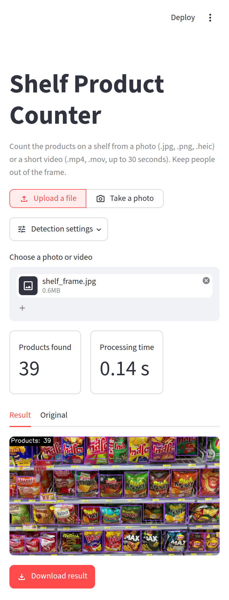 | 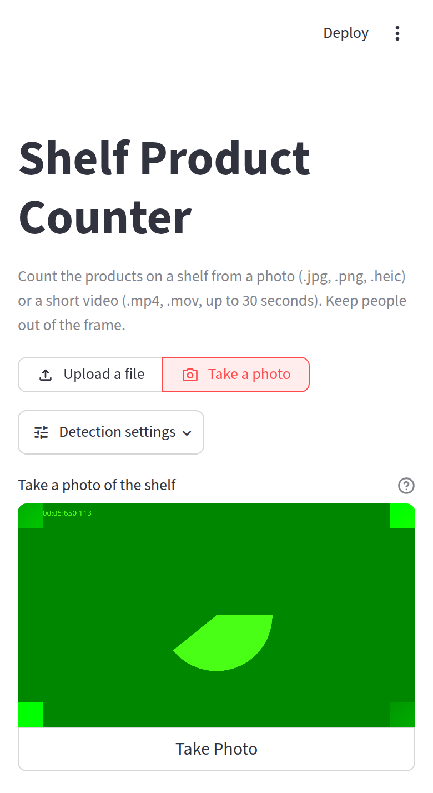 | 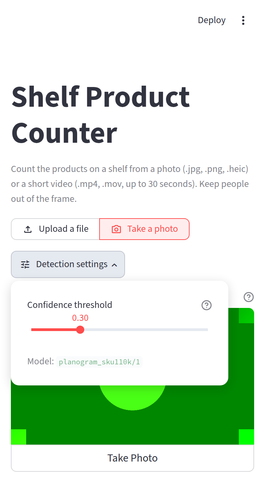 |

The camera screenshots use Chrome's fake test camera (the green test pattern), which is why they show no shelf.

---

## 10. Choosing the model

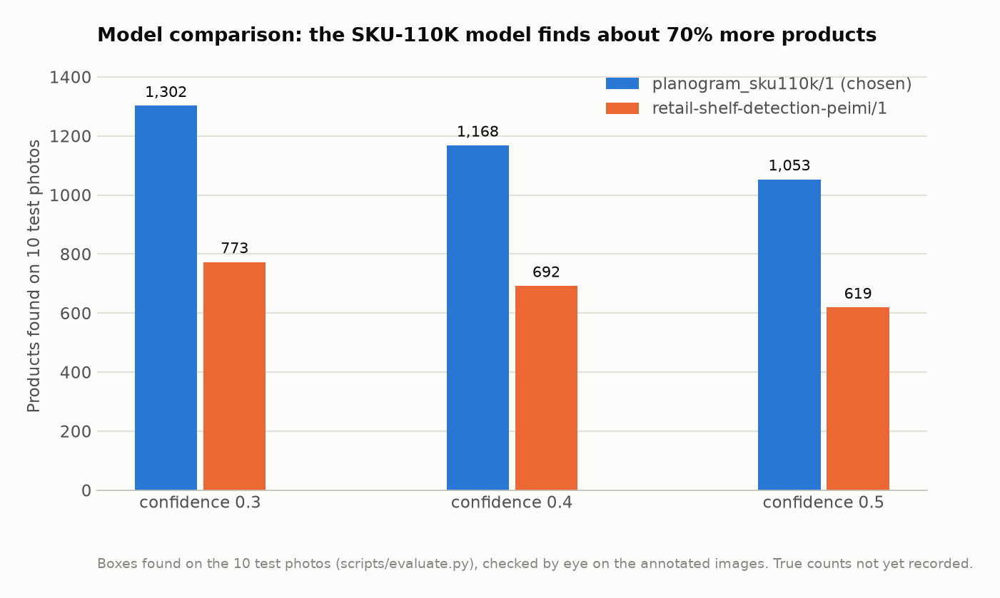

The brief asked to test 2 or 3 Universe models on 10 shelf photos and keep the one that misses the fewest
products. Three candidates were tried with `scripts/evaluate.py` and `scripts/probe_models.py`:

| Model | Result | Decision |
| --- | --- | --- |
| `planogram_sku110k/1` (class `0`) | 1,168 boxes at confidence 0.4; boxes products one by one across whole shelves | **chosen** |
| `retail-shelf-detection-peimi/1` (classes `product`, `empty`) | 692 boxes; skipped whole shelf sections (14 boxes on a snack stand where the chosen model finds 35) | rejected |
| `shelf-product/1` | recognises specific coffee brands, not generic products | ruled out |

Two findings changed the code: Inference stops at **300 boxes** by default (one packed shelf returned exactly 300
at every confidence; raising the cap gave 372 at 0.4), and confidence **0.3** found more real products than 0.4
with no false boxes on blank, grey, white or noise images.

**Open:** the comparison counts boxes found, checked by eye, not products missed. The brief's test needs true
counts in `test_images/true_counts.csv` (see [section 17](#17-known-limits-and-open-items)).

---

## 11. Speed and memory

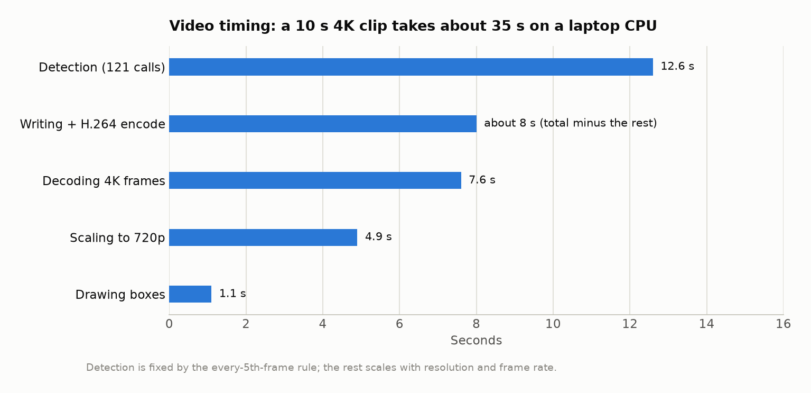

Measured on the development laptop (Intel i5-8350U, CPU only):

| Measurement | Result | Target |
| --- | --- | --- |
| Photo, average over 10 test photos | **0.11 s** (slowest 0.13 s) | under 5 s |
| 4000 × 3000 phone-size photo | 0.21 s | under 5 s |
| 10 s 4K 60 fps video (602 frames) | 34.7 s | completes with a count per frame |
| 4.3 s video at 1280 px | about 10 to 15 s | |
| Page visible after a reboot | title within 4 s, full page by 12 s (was a 20 to 25 s blank page) | |
| Memory with the model loaded | about 720 MB idle, 760 MB after a photo | |
| Memory after a 4K video | 1.1 to 1.25 GB (was up to 1.6 GB before `release_memory()`) | |

Detection is fixed by the every-5th-frame rule; decoding and scaling grow with the source resolution and frame rate,
so a 1080p 30 fps phone clip is much quicker than the 4K 60 fps test clip.

---

## 12. Deployment

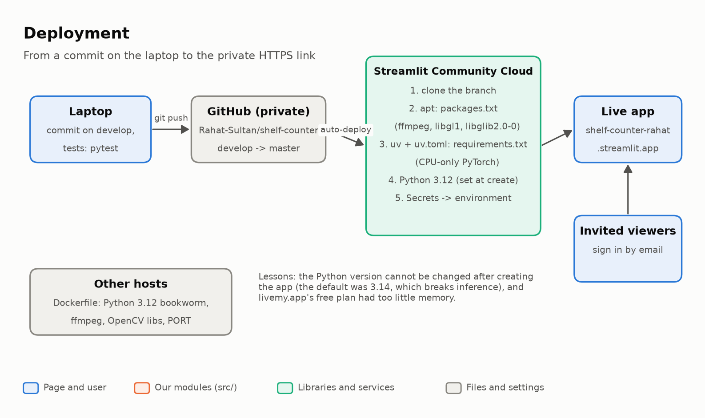

The live app runs on **Streamlit Community Cloud** from the private GitHub repository. Pushing to the deployed
branch redeploys it automatically. The install is driven by three files:

| File | Role on Community Cloud |
| --- | --- |
| `packages.txt` | system packages installed with apt: `ffmpeg`, `libgl1`, `libglib2.0-0` (needed by the desktop OpenCV build that Inference installs) |
| `requirements.txt` | exact Python packages, with the CPU-only PyTorch index |
| `uv.toml` | lets Community Cloud's `uv` installer pick each pinned version from either PyPI or the PyTorch index (without it, `uv` failed on `requests` and `pillow`) |

The step-by-step guide is [DEPLOY.md](../DEPLOY.md). Things learned on the way:

- **Python 3.12 must be chosen when the app is created**, and it cannot be changed later: the default was 3.14,
  which `inference` does not support, and the only fix was to delete and recreate the app.
- **The app is private** because the repository is private; viewers are invited by email.
- **livemy.app was tried first and dropped:** its free plan did not have enough memory, it has no screen for
  settings, and its AI agent could not restart the app after the key was added.
- **Vercel cannot run Streamlit**, and Hugging Face Docker Spaces now need a paid plan.
- A `Dockerfile` (Python 3.12 on Debian bookworm, ffmpeg, OpenCV libraries, listens on `PORT`) is kept for any
  Docker host.

---

## 13. Testing

Run all tests with `pytest -q` from `shelf-counter/` (43 tests, about 10 seconds). They need no API key and no
network, so they also work in a fresh clone.

| File | What it covers |
| --- | --- |
| `tests/test_validator.py` | unsupported type, small image accepted, oversized image rejected |
| `tests/test_video.py` | `fit_width`, short video accepted, 31 s video rejected, a count for every frame with detection on every 5th, H.264 output, no-ffmpeg fallback |
| `tests/test_errors.py` | `CONFIDENCE` from `.env` never crashes, `.env` not exported, environment overrides `.env`, every `friendly_message` case, empty and renamed files, blank image gives 0 |
| `tests/test_security.py` | decompression bombs, megapixel limit, the page modules do not import `inference`, model cache not in `/tmp`, Streamlit config deployable, deploy files present, `.env` and outputs ignored but `samples/outputs` tracked, secrets loaded before settings |
| `tests/test_formats.py` | HEIC read with correct colours and EXIF rotation, HEIC counted to a JPEG, text renamed to `.heic` rejected, `.mov` in H.264 and HEVC processed to an H.264 `.mp4` |

Beyond the unit tests, each phase was checked through the real page:

- **Streamlit's AppTest** drove the page through the full test matrix (T1 to T12 in
  [TESTING_AND_MODEL_SELECTION.md](TESTING_AND_MODEL_SELECTION.md)) plus the extra cases above.
- **Headless Chrome** loaded the page at desktop and phone width, uploaded files, and used a fake camera to take a
  photo in the camera mode.
- **Security scans** before the first deploy: `pip-audit` on all 226 packages, `bandit`, `ruff`, and
  `detect-secrets` over every commit on both branches.

---

## 14. Security and privacy

| Topic | What is in place |
| --- | --- |
| API key | only in `.env` (ignored by Git) or Community Cloud Secrets; never in the repository, the image or a log. Scanned history: no key in any of the commits |
| Who can use the app | the online app is private (invited emails). Locally, other devices on the same Wi-Fi can open it, for phone testing; use `--server.address localhost` to prevent that |
| Uploads | type, size, header, megapixel and duration checks before decoding; temporary folders deleted after each upload |
| Photos | processed on the server; Roboflow receives usage counts (frames, durations, a hashed API key), not images |
| Model cache | `~/.cache/shelf-counter/models`, not the shared `/tmp/cache` |
| Dependencies | pinned; one known issue accepted: `wheel` 0.45.1 (CVE-2026-24049, only in the `wheel unpack` command, which the app never runs; `inference` pins this version) |
| Tool settings | `.env`, `.streamlit/secrets.toml`, `.mcp.json`, `.agents/` and `.claude/` are ignored by Git |

---

## 15. Phases: what was done when


| Phase | Goal | What was delivered | Key finding |
| --- | --- | --- | --- |
| 0. Setup | a working environment | Python 3.12 venv, pinned `requirements.txt` with CPU-only PyTorch, first commit | the default Python 3.14 is too new for `inference`; the GPU PyTorch build did not fit in `/tmp` |
| 1. Model | choose the model that misses the fewest products | `scripts/evaluate.py`, `probe_models.py`; `planogram_sku110k/1` at confidence 0.3 | Inference's 300-box cap undercounted packed shelves |
| 2. Photo script | prove the pipeline on one image | `scripts/count_image.py`, readable count panel, scaled box lines | 0.11 s per photo, far under the 5 s target |
| 3. Web page | the pipeline behind an upload page | Streamlit page, cached model, slider, download, temporary folders | |
| 4. Video | annotated video with a count per frame | every 5th frame, 1280 px scaling, H.264 via ffmpeg, chart, CSV | OpenCV's `mp4v` does not play in browsers |
| 5. Errors | friendly messages, never a crash | validator checks, `errors.py`, settings that warn instead of crashing | `inference` itself parses `CONFIDENCE`; renamed and truncated files slipped through |
| (scan) | security and startup review | bomb protection, model cache out of `/tmp`, fast first paint, `samples/outputs` tracked | a 17 KB PNG used 432 MB; the page was blank for 20 to 25 s after a reboot |
| 6. Docs | easy to run, review and demo | README, STARTUP.md, DEPLOY.md, this document, PRD | |
| 7. Phones | the web app works well on a phone | camera mode, `.heic` and `.mov`, settings popover, phone layout, people reminder | the sidebar is hidden on phones; HEVC `.mov` decodes fine in OpenCV |
| 8. Deploy | a free HTTPS link | Streamlit Community Cloud, private, Python 3.12 | secrets were ignored until loaded early; Python cannot be changed after creating the app |

### Phase 7 in detail

Phase 7 was planned on 12 October in [MOBILE_PLAN.md](MOBILE_PLAN.md) (option A: one web app that works on
phones) and finished the same day:

- **Camera mode.** A segmented control switches between **Upload a file** and **Take a photo**. The camera widget
  requests 1080p and produces a JPEG that goes through exactly the same pipeline as an upload. Tested in Chrome with
  a fake camera at desktop and phone size.
- **iPhone photos.** New `src/image_io.py`: `.heic` and `.heif` are recognised by their header with `pillow-heif`,
  decoded with Pillow, rotated by their EXIF orientation, and converted to BGR. The result is always a JPEG. A
  HEIC copy of a test photo counted 232 products against 230 for the JPEG (the small difference comes from
  re-encoding).
- **iPhone videos.** `.mov` is accepted. OpenCV decoded H.264 and HEVC `.mov` files, including portrait ones, and
  the output is always an H.264 `.mp4`.
- **Phone layout.** The confidence slider moved from the sidebar into a **Detection settings** popover; metrics
  sit side by side; images, video and chart have alt text.
- **Tests.** `tests/test_formats.py` (6 tests) for HEIC colour, rotation and counting, renamed files, and `.mov` in
  both codecs. `pillow-heif==1.8.1` was added to `requirements.txt` and still resolves on Community Cloud.

---

## 16. Key decisions

| Decision | Reason |
| --- | --- |
| Streamlit, no database | the brief asks for a simple upload page; nothing needs to be kept between uploads |
| `planogram_sku110k/1` at confidence 0.3 | found far more real products than the alternatives; 0.3 added real products without false boxes |
| Local CPU inference, not Roboflow's hosted API | 0.11 s per photo is fast enough, it works offline once the model is downloaded, and photos stay on the server |
| No label text on boxes | the only class is named `0`, and labels hide products on dense shelves; the count panel carries the number |
| Detect on every 5th video frame, reuse in between | the brief's speed rule, while every frame still gets boxes and a count |
| Headline video count = highest per-frame count | PRD assumption A5 (to confirm with the project owner) |
| Scale video to 1280 px before detection | same counts, much smaller and faster output |
| Re-encode video with ffmpeg | OpenCV's `mp4v` does not play in browsers |
| Validate before decoding, including megapixels | cheap checks, clear messages, protection against decompression bombs |
| `.env` read privately, not exported | `inference` crashes on a bad `CONFIDENCE` in the environment |
| Import `inference` only when the model loads | the page appears within seconds instead of after 20 seconds |
| Model cache in the home folder | `/tmp` is wiped on reboot, which broke offline use |
| One web app for phones (option A), not a separate mobile app | far less work; phones already get camera and upload through the browser |
| Streamlit Community Cloud | the only free host that fits the memory need; private by default for a private repository |
| `develop` for changes, `master` for the official version | try things without breaking the live app |

---

## 17. Known limits and open items

### Limits of the app

- **Small or low-resolution photos miss products** (a 202 × 360 web image found far fewer). Use full-resolution
  camera photos.
- **Very dark photos return fewer products** (a shelf darkened to 15% brightness dropped from 230 to 155).
- **Dense shelves and glare** can still cause misses.
- **A partly damaged photo** is counted as far as it decodes, without a warning (OpenCV does not report it).
- **Video is slower than photos:** about 3.5 times the clip length for 4K 60 fps on a laptop CPU.
- **4K videos use up to about 1.25 GB of memory**, which may approach Community Cloud's limit (documented only as
  690 MB to 2.7 GB). Photos are well within it.
- **Phone videos over 100 MB are rejected.** A 30-second 4K iPhone video can be larger; shorter or 1080p clips fit.
- **The camera mode needs HTTPS or `localhost`.** It works on the live link and on the laptop, but not when a
  phone opens the laptop's Wi-Fi address (use the upload box's **Take photo** there).
- **The app sleeps** after about 12 hours without visitors on Community Cloud; the first visit then takes about a
  minute.

### Open items (things that are easy to miss)

| Item | Why it matters | Owner |
| --- | --- | --- |
| Fill in `test_images/true_counts.csv` and rerun `scripts/evaluate.py` | the brief picks the model by "misses the fewest products"; today's evidence is boxes found | you |
| Take 10 of your own shelf photos and a 10 to 25 s video | the current test photos are small web images; the brief asks for your own | you |
| 5 example inputs and outputs in `samples/` | a brief deliverable; use your own photos (licence) | you, then generate outputs with `scripts/count_image.py` |
| A teammate runs the app from the README in under 10 minutes | a "Done when" criterion; not yet tested | a teammate |
| Demo to the team | a brief deliverable; the script is in TESTING_AND_MODEL_SELECTION.md section 6 | you |
| Confirm the model's licence on its Universe page | needed before publishing results or samples | you |
| Answer the PRD's open questions with the project owner | project name, size limits, video headline count | you and Syed |
| Push `develop` and `master` after each merge | the live app and GitHub only see pushed commits | you |
| Delete the old copies in the parent folder | the parent folder holds outdated `PRD.md`, `ARCHITECTURE.md`, `TESTING_AND_MODEL_SELECTION.md` and an empty Git repo | you |
| Revoke the old livemy.app MCP token and delete the livemy.app project | it still has access to that account | you |

---

## 18. How to extend the project

| Change | Where |
| --- | --- |
| Another photo format | add the extension in `config.IMAGE_EXTENSIONS`; teach `image_io.can_read_header()` and `read_image()` to read it |
| Another video format | add it to `config.VIDEO_EXTENSIONS` and check that OpenCV decodes it (`tests/test_formats.py` shows how) |
| A different Roboflow model | change `MODEL_ID` and `PRODUCT_CLASS` in `.env` or the Secrets; compare first with `scripts/evaluate.py` |
| An open-vocabulary fallback (YOLO-World) | install `inference[yolo-world]` and add a detector class with the same `detect(frame, confidence)` method |
| Roboflow's hosted API instead of local inference | replace `ShelfDetector` with one that calls `inference-sdk`; removes PyTorch (about 150 to 250 MB of memory), but photos go to Roboflow and each call counts against the plan |
| Different limits | `src/config.py` (and `maxUploadSize` in `.streamlit/config.toml` for the browser-side limit) |
| A separate mobile app | see options B and C in [MOBILE_PLAN.md](MOBILE_PLAN.md): an API around `src/`, then a Flutter app |

When changing code, add or update a test in `tests/`, run `pytest -q`, and regenerate the figures if the
architecture changed ([section 20](#20-regenerating-the-images)).

---

## 19. Glossary

| Term | Meaning |
| --- | --- |
| Roboflow Universe | a public catalogue of datasets and trained models |
| Roboflow Inference | the Python package that downloads and runs Roboflow models |
| Supervision | a Roboflow library for detections, drawing boxes and reading and writing video |
| SKU-110K | a public dataset of about 11,700 densely packed retail shelf photos |
| Confidence threshold | how sure the model must be before a box counts (0.3 by default) |
| BGR | the colour order OpenCV uses (blue, green, red) |
| HEIC / HEIF | the photo format iPhones save by default |
| HEVC (H.265) / H.264 | video codecs; iPhones record HEVC, browsers all play H.264 |
| `mp4v` | the MPEG-4 Part 2 codec OpenCV writes; most browsers do not play it |
| Decompression bomb | a small file that expands to a huge image in memory when decoded |
| EXIF orientation | a flag in phone photos saying how the camera was held |
| Streamlit Community Cloud | Streamlit's free hosting for apps in GitHub repositories |
| `st.cache_resource` | a Streamlit cache that keeps one object (here, the model) for the whole server |

---

## 20. Regenerating the images

All images in `docs/images/` can be rebuilt after the code changes:

```bash
cd shelf-counter
python docs/figures/make_figures.py                      # diagrams and charts (01 to 11)
streamlit run app.py --server.port 8503 --server.headless true &
python docs/figures/take_screenshots.py --photo path/to/shelf.jpg --video path/to/shelf.mp4   # 12 to 17
```

The diagrams are drawn in code in `docs/figures/make_figures.py`, so changing a box or an arrow is a small edit.
The charts use the measured numbers listed in the script. The screenshots use your own photo and video; the
current ones come from a frame of the test video in `test images/`.
